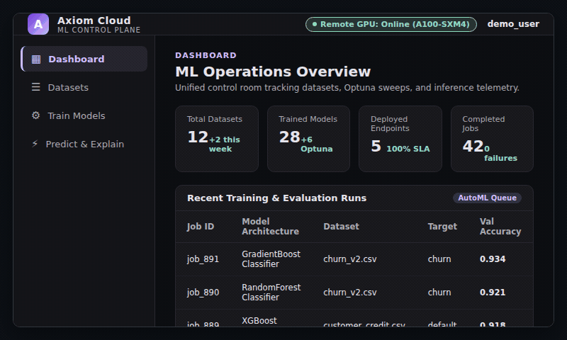
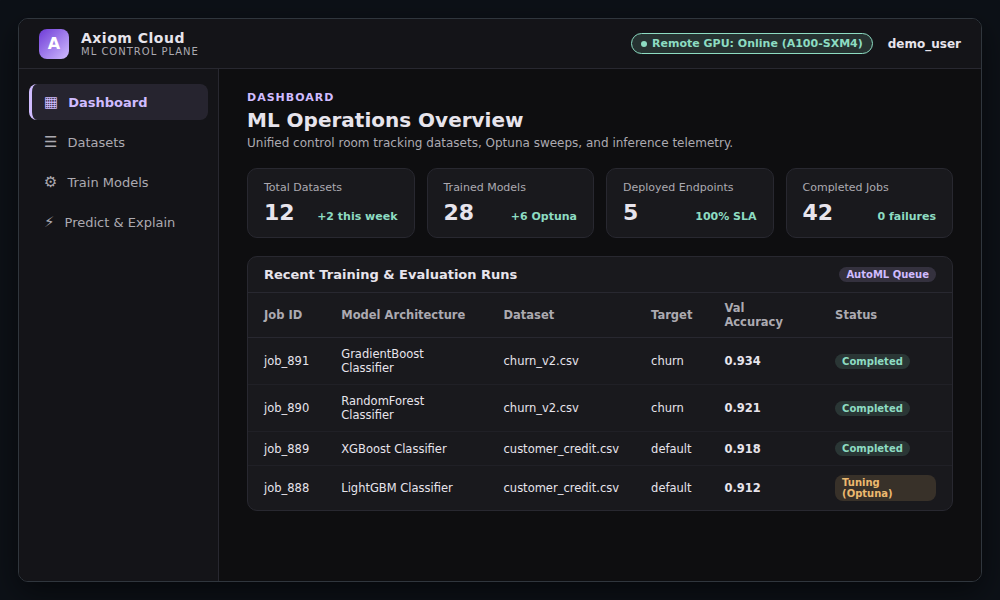
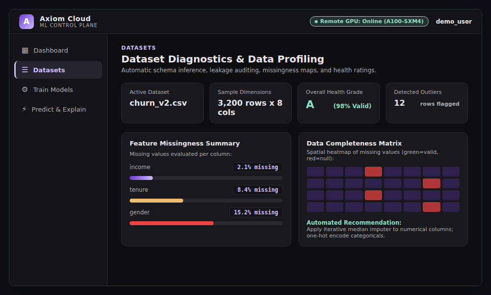
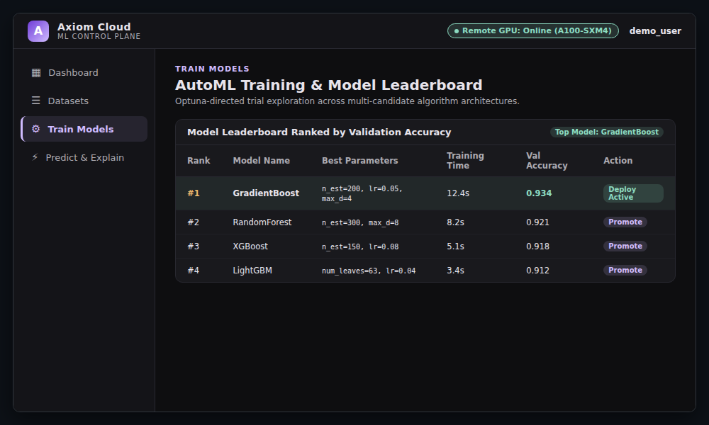
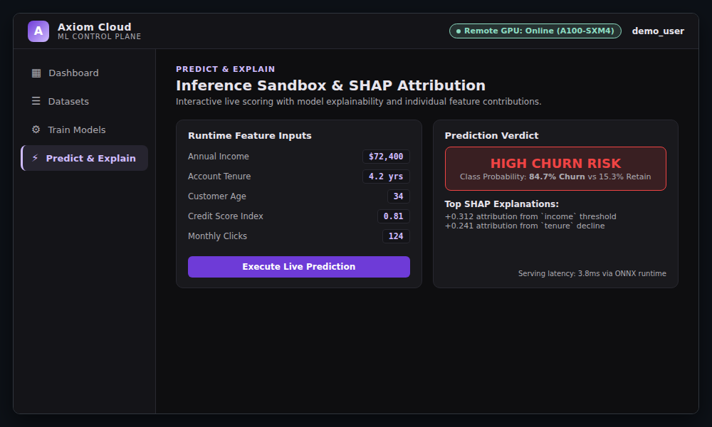
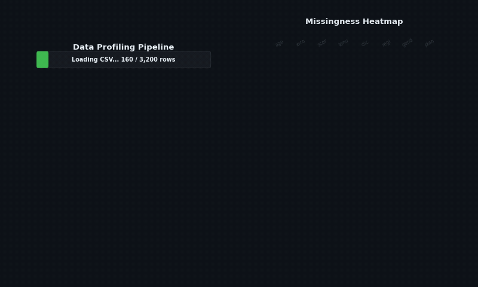
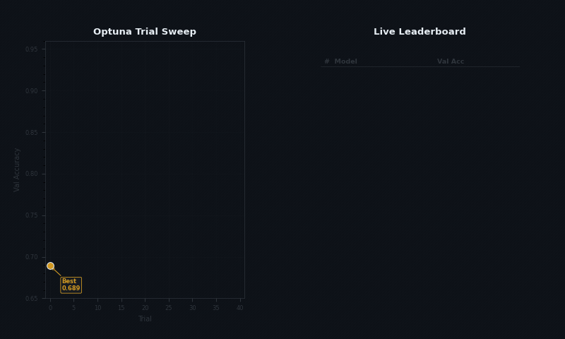
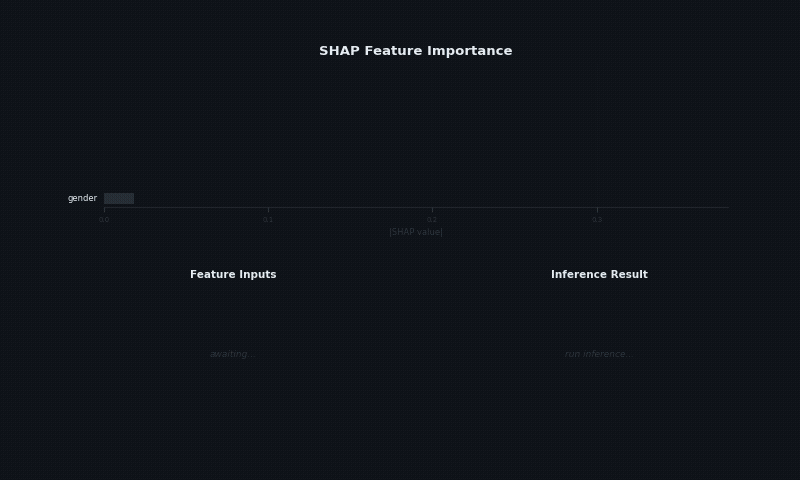

{ .tiet-logo }

**UCS503: Software Engineering (Project)**  
**Thapar Institute of Engineering and Technology, Patiala**  
**Department of Computer Science and Engineering**

# Sukio: Production-Grade AutoML Platform

**Project Team:**
- **Keshav Juneja** (Roll No: `1024030692`, CSED)
- **Satwik Sinha** (Roll No: `1024030699`, CSED)

**Course:** UCS503P (Software Engineering Project) — 2026–27 ODD Semester  
**Instructor:** Dr. Raghav B. Venkataramaiyer (`bv.raghav@thapar.edu`)

---

## 1. Overview

**Sukio** is an enterprise-grade, full-stack AutoML platform and machine learning marketplace engineered for dataset diagnostics, automated multi-model training, explainability (SHAP & LIME), and low-latency inference. 

Originally prototyped with FastAPI and Next.js, the control plane has been ported to **Java 21 (Spring Boot 3.3)** paired with **Thymeleaf + HTMX**, creating a hyper-responsive, server-driven web architecture styled under the technical **Axiom Obsidian** dark design system (`#0e0e10` base, violet accents).



---

## 2. Core Control Surfaces

| Control Surface | Live Preview | Capability Highlights |
|---|---|---|
| **Platform Dashboard**<br>`/dashboard` |  | Cluster health, active training runs, registered models inventory, throughput metrics, and dataset catalog. |
| **Dataset Diagnostics**<br>`/datasets` |  | Multi-format upload (CSV, `.xlsx`, `.xls`), composite quality score (0–100), missingness analysis, and target leakage detection. |
| **AutoML Training Studio**<br>`/training` |  | Model candidate selection, Optuna trial budgets, cross-validation parameters, and live HTMX polling progress. |
| **Inference & Explainability**<br>`/models` & `/predict` |  | Ranked leaderboard, champion model badges, global/local SHAP feature rankings, and real-time prediction confidence gauge. |

---

## 3. Pipeline Walkthroughs

### Dataset Upload & Profiling
Upload tabular files or load benchmark datasets (Iris, Titanic, California Housing, Diabetes) to receive immediate schema inspection and composite data health metrics.



### AutoML Training & Live Leaderboard
Asynchronous training executions run across multiple estimators concurrently. Training progress is polled and updated live without requiring full-page reloads.



### SHAP Explainability & Inference Sandbox
Inspect trained decision boundaries through Shapley additive attributions and test models via live parameter adjustments.



---

## 4. Architecture & Tech Stack

```
┌────────────────────────────────────────────────────────────┐
│                    Browser Client UI                       │
│        Thymeleaf 3 + HTMX 1.9 + Axiom Obsidian CSS        │
│   (Dashboard, Datasets, Training Studio, Models, Predict)  │
└───────────────────────────┬────────────────────────────────┘
                            │  HTTP / HTMX Lazy-Loading
┌───────────────────────────▼────────────────────────────────┐
│             Spring Boot 3 Control Plane (Port 8000)        │
│   • FrontendController  • DatasetController (Apache POI)   │
│   • TrainingController  • ModelController (SHAP Engine)    │
│   • Async TaskExecutor  • Spring Data JPA Repositories     │
└────────┬──────────────────────────────────┬────────────────┘
         │                                  │
┌────────▼──────────┐             ┌─────────▼────────────────┐
│    Database       │             │   Local Storage Filesystem│
│  H2 (Dev / Local) │             │   • storage/datasets     │
│  PostgreSQL (Prod)│             │   • storage/models       │
└───────────────────┘             │   • storage/reports      │
                                  └──────────────────────────┘
         │                                  │
┌────────▼──────────────────────────────────▼────────────────┐
│              ML Execution & Training Engine                │
│   • Embedded Simulation Fallback (100% self-contained)    │
│   • External Python Microservice (Optuna, Scikit, SHAP)    │
│   • Authenticated Local GPU Training Agent (CLI mode)      │
└────────────────────────────────────────────────────────────┘
```

- **Backend**: Java 21, Spring Boot 3.3.4, Spring Data JPA, Spring Security
- **Frontend**: Thymeleaf 3, HTMX 1.9.10, Axiom Obsidian CSS (`#0e0e10`, violet accents)
- **Database**: In-memory H2 (Local Development mode) or PostgreSQL 16 (Production mode)
- **AutoML**: Scikit-Learn, Optuna, SHAP, and embedded fallback simulation
- **Testing**: Playwright Test Suite (`code/tests/playwright/`) in Brave Browser

---

## 5. Running Locally

### Development Mode (In-Memory H2)
From the repository root:

```powershell
cd code/backend-java
.\mvnw.cmd spring-boot:run "-Dspring-boot.run.profiles=local"
```

Access the control plane at: `http://localhost:8000/`

### Running Automated Playwright Tests
Execute the 16-test suite visibly in Brave Browser:

```powershell
cd code/tests/playwright
npm run test:demo
```
